# MahaVista — Discover Maharashtra, Experience Its Heritage

<p align="center">
  
</p>

<p align="center">
  <strong>An AI-powered tourism and cultural heritage platform for exploring Maharashtra.</strong>
</p>

<p align="center">
  Discover destinations, plan trips, explore festivals, learn through animated stories, solve cultural riddles, and support local artisans—all in one place.
</p>

<p align="center">

  
  
  
  
  
</p>

---

## Table of Contents

- [About the Project](#about-the-project)
- [Problem Statement](#problem-statement)
- [Project Objectives](#project-objectives)
- [Key Features](#key-features)
- [Project Screenshots](#project-screenshots)
- [Technology Stack](#technology-stack)
- [System Architecture](#system-architecture)
- [Project Structure](#project-structure)
- [Prerequisites](#prerequisites)
- [Installation and Setup](#installation-and-setup)
- [Environment Variables](#environment-variables)
- [Running the Application](#running-the-application)
- [API Documentation](#api-documentation)
- [Core User Workflows](#core-user-workflows)
- [Security and Privacy](#security-and-privacy)
- [Troubleshooting](#troubleshooting)
- [Acknowledgements](#acknowledgements)

---

## About the Project

**MahaVista** is a tourism, culture, and heritage discovery platform designed to help people explore Maharashtra in a more interactive and engaging way. Instead of limiting tourism information to static articles, the platform brings together destination discovery, personalized recommendations, trip-planning enquiries, cultural storytelling, educational games, festival information, and local artisan products.

The platform is intended for tourists, families, students, children, culture enthusiasts, and local artists. It combines a tourism-focused user experience with AI-assisted features and educational content to make regional heritage easier to discover.

MahaVista was previously developed under the name **Mystic Trails of Maharashtra**.

### Project at a Glance

| Item | Description |
|---|---|
| Project name | MahaVista |
| Domain | Tourism, culture, heritage, and travel planning |
| Frontend | React and Tailwind CSS |
| Backend | FastAPI and Python |
| Database | MongoDB Atlas |
| AI integration | Gemini API for supported AI-powered features |
| Main audience | Tourists, families, students, children, and local artisans |


## Problem Statement

Tourists often need to visit several websites or sources to find destination details, cultural background, travel suggestions, festival information, and local experiences. Heritage education can also be difficult to make engaging for younger audiences, while regional artisans may have limited visibility beyond their local markets.

MahaVista aims to bring these experiences together in one platform by:

- Making destinations and cultural landmarks easier to explore.
- Offering personalized suggestions based on travel preferences.
- Helping visitors discover local attractions and plan a trip.
- Presenting cultural knowledge through quizzes, riddles, and animated storytelling.
- Highlighting festivals, traditional crafts, and regional products.
- Providing an extensible foundation for multilingual and AI-assisted tourism experiences.

## Project Objectives

1. **Promote tourism:** Make Maharashtra's destinations, history, and culture easier to discover.
2. **Personalize travel discovery:** Suggest destinations using preferences such as month, interests, budget, companions, and trip duration.
3. **Encourage cultural learning:** Present heritage and traditions in engaging formats for children and students.
4. **Support trip planning:** Help visitors explore attractions and submit trip-planning enquiries.
5. **Highlight local artisans:** Give traditional products and crafts a dedicated place in the platform.
6. **Improve accessibility:** Work toward multilingual information and an approachable interface.
7. **Use technology meaningfully:** Combine a modern web interface, API-driven backend, database storage, and supported AI integrations.

## Key Features

### 1. Interactive Heritage and Destination Map

The interactive map provides a visual way to explore geographical areas and destinations.

- Browse map-based destination information.
- Select a district, city, or supported landmark to see an information card.
- View a summary and relevant imagery.
- Open additional historical or cultural information where available.
- Continue to destination details and trip-planning options.

**Screenshot placeholder**

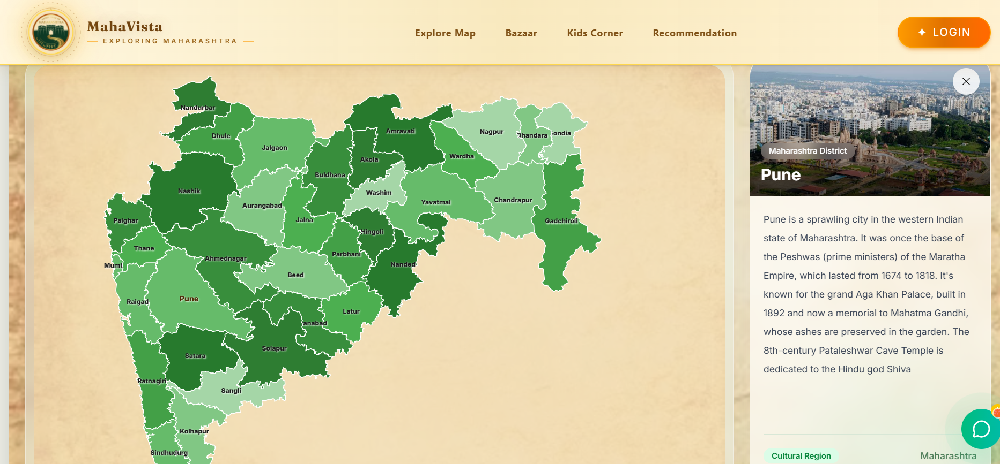

### 2. Personalized Destination Recommendation System

The recommendation module helps users discover destinations that fit their trip preferences. Depending on the options supported by the current implementation, users can provide details such as:

- Month of travel
- Interests, such as nature, heritage, photography, food, or adventure
- Travel companions
- Budget
- Trip duration
- Weather preference
- Preferred transport
- Starting city
- Adventure level
- Places or activities they want to avoid

The system evaluates destination suitability and can return a ranked list of recommendations. The intention is to make destination discovery more relevant than a generic list of popular places.

**Screenshot placeholder**

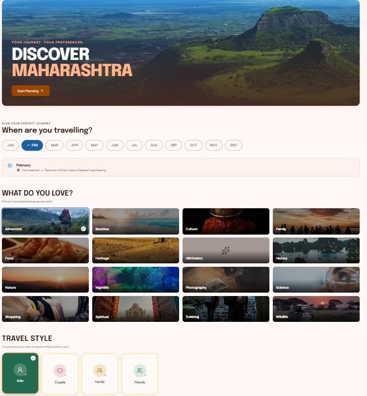
)

### 3. Festival Calendar

The festival calendar helps visitors explore cultural celebrations and consider festival timing when planning a trip.

Potential information displayed by the module includes:

- Festival name and date
- Short description and cultural significance
- Related locations
- Relevant travel or destination suggestions

Festival dates can vary by year and local observance. The application should identify its information source and show the applicable year wherever dates are displayed.

**Screenshot placeholder**

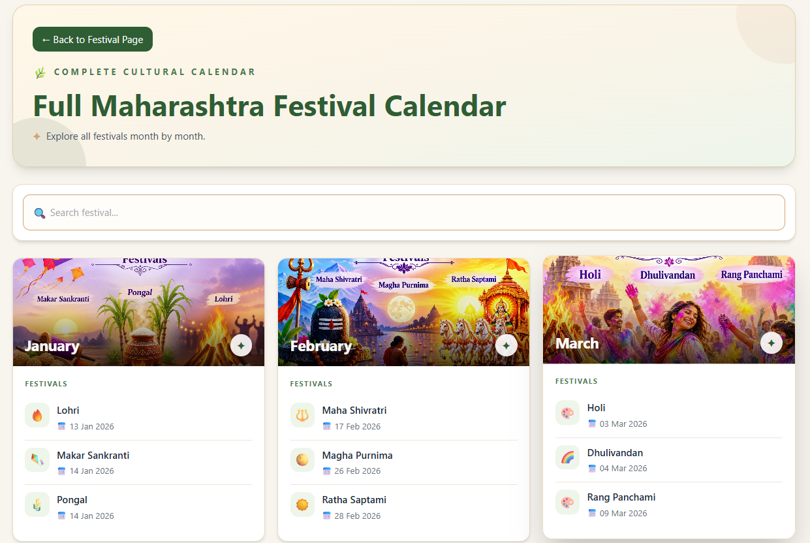

### 4. AI Tourism Assistant / Chatbot

The tourism assistant is designed to provide a convenient way for visitors to ask questions and navigate tourism information.

Depending on the configured implementation, it can help users:

- Explore destinations and attractions.
- Learn about local history and traditions.
- Discover activities or travel ideas.
- Understand available platform features.
- Get guidance on trip-planning options.

AI-generated responses should be treated as assistance rather than a substitute for checking important travel details. Availability, prices, transport schedules, and event dates should be verified using reliable, current sources.

**Screenshot placeholder**

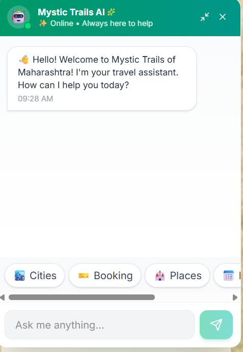

### 5. Kids' Animated Storytelling

The kids' section introduces Maharashtra's heritage and culture through child-friendly stories and animated videos.

Example themes include:

- Famous forts, cities, and historical landmarks
- Traditional food and regional customs
- Festivals and cultural celebrations
- Local art, crafts, and heritage
- Stories about places across Maharashtra

The project concept includes Hindi voiceovers and AI-assisted video creation. Actual video availability depends on the media assets included in the deployed application.

**Screenshot placeholder**

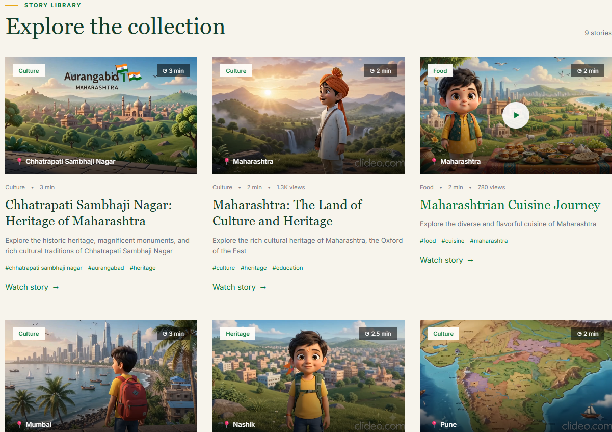

### 6. Maharashtra Culture Quiz

The quiz module makes cultural learning interactive. Questions can cover topics such as:

- Maharashtra's history and heritage
- Famous destinations and monuments
- Traditional food
- Festivals and celebrations
- Art, crafts, and regional traditions

The quiz can be used by students, children, families, and anyone interested in learning about Maharashtra.

**Screenshot placeholder**

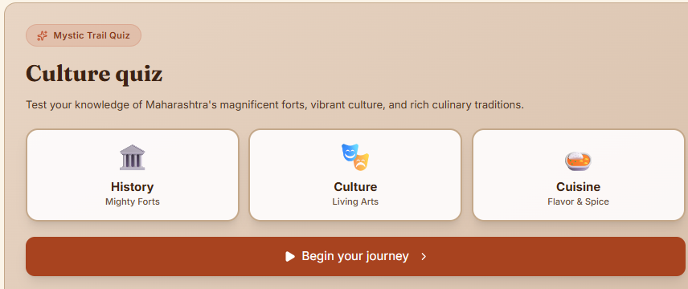

### 7. Maharashtra Mystery and Riddle Game

The mystery module encourages users to solve culture- and heritage-related riddles.

The planned experience includes:

- A random or daily mystery
- Clues that can be revealed progressively
- Answer submission
- Feedback based on the submitted answer
- A leaderboard or winner display, where enabled
- A concept for featuring a winner in an AI-generated cultural video

The exact scoring, daily reset rules, and winner-selection process depend on the active backend implementation.

**Screenshot placeholder**

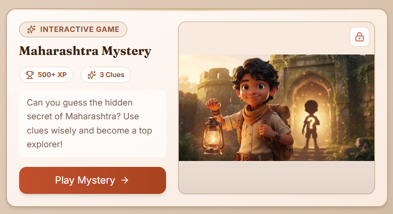

### 8. Local Artist and Handicraft Marketplace

The marketplace highlights regional crafts and traditional products, helping visitors discover local art and cultural items.

Example product categories include:

- Warli paintings
- Kolhapuri chappals
- Paithani sarees
- Sawantwadi wooden toys

Product listings should provide accurate descriptions, images, pricing, availability, and seller information wherever those details are supported. A displayed product should not be assumed to be purchasable unless the relevant ordering or checkout workflow is implemented.

**Screenshot placeholder**

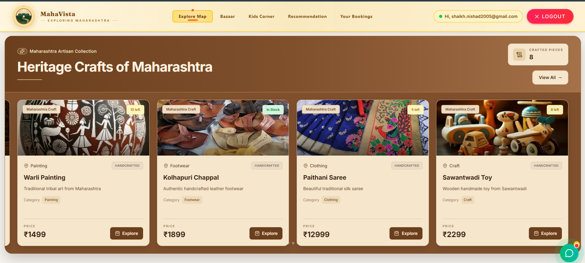

### 9. Destination Details and Trip-Planning Enquiries

The trip-planning experience helps users move from discovering a place to considering a visit.

Depending on the destination page, visitors may be able to explore:

- Places to visit
- Local food and experiences
- Accommodation or stay suggestions
- Trip duration and budget considerations
- A form for submitting trip requirements

Enquiry forms should clearly communicate what information is collected and should avoid requesting unnecessary personal data.

**Screenshot placeholder**

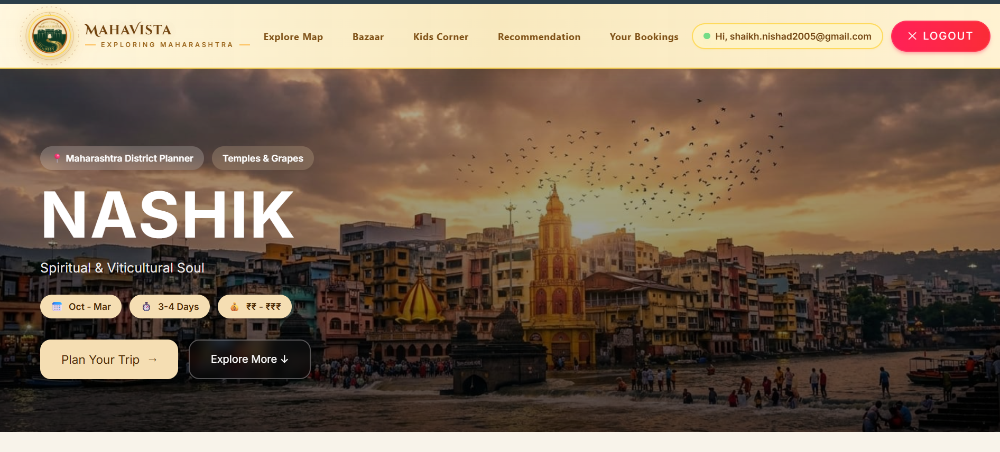(frontend/public/images/trip-planner1.png)
(frontend/public/images/trip-planner2.png)

### 10. Authentication and User Access

Authentication provides a foundation for user-specific experiences and access-controlled features. Available capabilities depend on the current implementation and may include registration, login, and protected pages.

Credentials and tokens must be handled securely. Never commit real passwords, access tokens, API keys, or private environment files to source control.

**Screenshot placeholder**

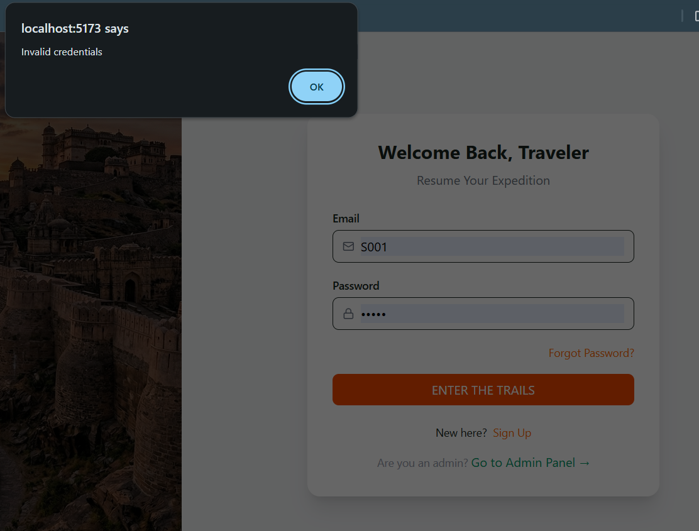

### 11. Admin Dashboard

The administration area is intended to help authorized administrators monitor platform information and manage supported records.

Dashboard information may include:

- User statistics
- Booking or enquiry counts
- Destination or city information
- Revenue-related statistics, if implemented
- Booking or enquiry statuses

Only show metrics that are backed by actual data and available backend functionality. Admin endpoints and pages should be protected by proper authorization.

**Screenshot placeholder**

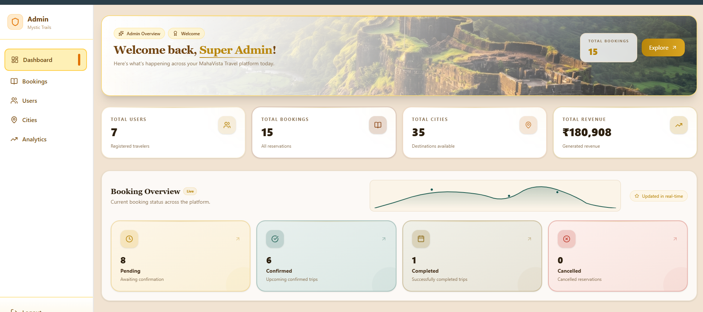

### 12. Multilingual Support

MahaVista aims to make tourism information more accessible to visitors who prefer different languages. The exact languages and translated content available depend on the current implementation.

For a reliable multilingual experience, translate navigation, validation messages, forms, and essential tourism information consistently, and review culturally specific translations for accuracy.
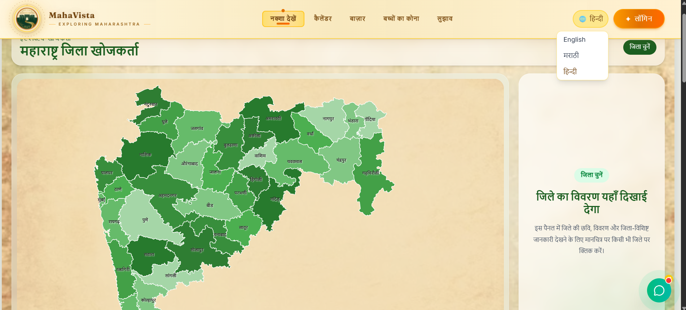
---

## Project Screenshots

| Screen | Placeholder image |
|---|---|
| Interactive map | `frontend/public/images/MapScreenshot.png` |
| Recommendations | `frontend/public/images/RecomScreenshot.png` |
| Festival calendar | `frontend/public/images/festival-calendar.png` |
| AI chatbot | `frontend/public/images/ai-chatbot.png` |
| Kids' stories | `frontend/public/images/kids-storytelling.png` |
| Culture quiz | `frontend/public/images/culture-quiz.png` |
| Mystery / riddle | `frontend/public/images/mystery-riddle.png` |
| Artist marketplace | `frontend/public/images/artist-marketplace.png` |
| Trip planner | `frontend/public/images/trip-planner2.png` |
| Login / registration | `frontend/public/images/authentication.png` |
| Admin dashboard | `frontend/public/images/admin-dashboard.png` |
| Multilingual Support| `frontend/public/images/multiLang.png` |

## Technology Stack

| Technology | Role in the project |
|---|---|
| React 18 | Builds reusable and interactive frontend components |
| Tailwind CSS | Provides utility-based styling and responsive layouts |
| JavaScript | Implements client-side interactions and API requests |
| Python | Backend programming language |
| FastAPI | Provides HTTP API endpoints and backend services |
| Pydantic | Validates and structures request and response data where used |
| MongoDB Atlas | Cloud-hosted database for supported application data |
| Gemini API | Supports configured AI-powered functionality |
| Uvicorn | Runs the FastAPI application during development |
| Swagger UI | Allows developers to inspect and test documented API endpoints |

Additional libraries may be used for mapping, geographic data, charts, routing, icons, or media. Check the frontend and backend dependency files for the complete and current list.

## System Architecture

At a high level, the application follows this flow:

```text
+------------------------------+
|       User's Browser         |
|  React + Tailwind CSS        |
|  Maps, Pages, Forms, Games   |
+---------------+--------------+
                |
                | HTTP / JSON API requests
                v
+------------------------------+
|        FastAPI Backend       |
| Routes, Validation, Logic   |
| Authentication / Services   |
+----------+-----------+-------+
           |           |
           v           v
+----------------+  +--------------------+
| MongoDB Atlas  |  | Gemini API         |
| Stored data    |  | AI features where  |
| and records    |  | configured         |
+----------------+  +--------------------+
```

### Request lifecycle

1. A visitor opens a page or interacts with a feature in the React frontend.
2. The frontend sends an HTTP request to the relevant backend endpoint when required.
3. FastAPI validates the request and runs the relevant application logic.
4. The backend reads or writes supported records in MongoDB Atlas.
5. If an AI-enabled feature requires it, the backend or configured integration communicates with the Gemini API.
6. The backend returns a response to the frontend.
7. The frontend displays the result to the visitor.

The exact request flow varies by feature. Keep API keys and database credentials on the server whenever possible; do not expose private server credentials in frontend code.

## Project Structure

The following is an **illustrative structure**, not a verified listing of every file in the current repository. Update it to match your actual folders.

```text
MahaVista/
├── frontend/
│   ├── public/
│   │   ├── images/
│   │   └── videos/
│   ├── src/
│   │   ├── Components/
│   │   ├── Pages/
│   │   ├── assets/
│   │   ├── data/
│   │   ├── App.jsx
│   │   └── main.jsx
│   ├── package.json
│   └── .env.example
│
├── backend/
│   ├── app/
│   │   ├── main.py
│   │   ├── routes/          # If used by the current codebase
│   │   ├── models/          # If used by the current codebase
│   │   └── services/        # If used by the current codebase
│   ├── requirements.txt
│   ├── seed_stories.py      # If present in the current repository
│   └── .env.example
│
├── docs/
│   └── screenshots/
│       ├── home.png
│       ├── interactive-map.png
│       ├── recommendations.png
│       ├── festival-calendar.png
│       ├── ai-chatbot.png
│       ├── kids-storytelling.png
│       ├── culture-quiz.png
│       ├── mystery-riddle.png
│       ├── artist-marketplace.png
│       ├── trip-planner.png
│       ├── authentication.png
│       └── admin-dashboard.png
│
├── .gitignore
└── README.md
```

### Important folders

- `frontend/src/`: React pages, components, and client-side logic.
- `frontend/public/images/`: Public image assets, if organized this way.
- `frontend/public/videos/`: Public video assets, if organized this way.
- `backend/app/`: FastAPI application code.
- `backend/requirements.txt`: Python dependencies.
- `docs/screenshots/`: README screenshots and project documentation assets.

Your actual structure may use different names. Preserve the existing project organization rather than moving files solely to match this example.

## Prerequisites

Install or obtain access to the following before running the project:

- **Git** to clone and manage the repository.
- **Node.js and npm** to install and run the React frontend.
- **Python** compatible with the backend dependencies.
- **MongoDB Atlas** account and a database connection string.
- **Gemini API key**, only if the AI features you want to run require it.

Check the repository's dependency files and any existing setup documentation for the exact supported versions. The commands below use Windows PowerShell examples and may need small adjustments for macOS or Linux.

## Installation and Setup

### 1. Clone the repository

Replace the sample repository URL with your actual GitHub repository URL.

```bash
git clone https://github.com/YOUR-USERNAME/YOUR-REPOSITORY.git
cd YOUR-REPOSITORY
```

### 2. Set up the frontend

Open a terminal in the frontend directory:

```bash
cd frontend
npm install
```

If the project uses a different package manager, follow the lockfile and project conventions already present.

Create a frontend environment file if the application requires one. For Vite projects, frontend variables exposed to browser code commonly use the `VITE_` prefix.

Example `.env.example`:

```env
VITE_API_BASE_URL=http://127.0.0.1:8010
```

Use the API URL and port expected by your actual backend and frontend code. Do not put server-only secrets in a frontend environment file: variables bundled into a browser application are not private.

### 3. Set up the backend

Open a separate terminal and navigate to the backend directory:

```powershell
cd backend
```

Create a Python virtual environment:

```powershell
py -m venv venv
```

Activate it in Windows PowerShell:

```powershell
.\venv\Scripts\Activate.ps1
```

If PowerShell blocks script execution, use an approved environment-specific solution or activate the environment from Command Prompt:

```bat
venv\Scripts\activate.bat
```

Install the backend dependencies:

```powershell
python -m pip install --upgrade pip
pip install -r requirements.txt
```

If a dependency is missing, confirm that it is included in `requirements.txt` and compatible with your Python version. Avoid installing random package versions without checking the project's dependency requirements.

### 4. Configure MongoDB Atlas

1. Create or open your MongoDB Atlas project.
2. Create a database user with only the permissions the application requires.
3. Configure network access for your development environment.
4. Copy the database connection string.
5. Add it to the backend's local environment file.
6. Confirm that the configured database name matches the application's expected name.

Example backend `.env.example`:

```env
MONGO_URI=mongodb+srv://<username>:<password>@<cluster-url>/<database-name>
MONGO_DB_NAME=mystic_trails
GEMINI_API_KEY=<your-gemini-api-key>
```

These are **example variable names**. Your code may expect different names, and the Gemini key may be configured elsewhere. Verify the settings read by the current backend before using this template.

Do not commit your real `.env` file. Add it to `.gitignore` and provide a safe `.env.example` containing placeholders only.

### 5. Configure AI functionality

If the project uses Gemini for the chatbot, generated storytelling, or other AI-enabled features:

1. Obtain an API key through the appropriate Google AI developer service.
2. Configure the key using the variable name expected by your code.
3. Keep private API keys on the backend where possible.
4. Handle API errors, quota limits, and unavailable responses.
5. Verify the provider's current terms, supported models, and usage limits.

If a feature is not configured, the rest of the application should communicate that limitation clearly rather than implying that AI functionality is working.

## Running the Application

Run the backend and frontend in **separate terminal windows**.

### Start the backend

From the `backend` directory, with the virtual environment activated:

```powershell
uvicorn app.main:app --reload --port 8010
```

This command assumes that the FastAPI application is available as `app.main:app`. If the entry point or port differs in your repository, use the correct existing command.

When the server starts successfully, open:

- API base URL: `http://127.0.0.1:8010`
- Swagger UI: `http://127.0.0.1:8010/docs`
- ReDoc: `http://127.0.0.1:8010/redoc`

The documentation URLs work only if the application is running and its documentation endpoints are enabled.

### Start the frontend

In a second terminal:

```powershell
cd frontend
npm run dev
```

Open the local URL printed by Vite in the terminal. It is commonly `http://localhost:5173`, but the port may differ if it is already in use or has been configured.

### Verify the connection

1. Confirm the backend starts without import or configuration errors.
2. Open the Swagger UI and check that the expected API routes are listed.
3. Open the frontend and confirm that the main page loads.
4. Test a feature that retrieves backend data.
5. Check the browser developer console and backend terminal for errors.
6. Verify that database-backed features work with your configured Atlas connection.

## Environment Variables

The following table lists example settings that may be required. **Use the exact variable names read by your current source code.**

| Variable | Where it belongs | Purpose |
|---|---|---|
| `MONGO_URI` | Backend `.env` | MongoDB Atlas connection string |
| `MONGO_DB_NAME` | Backend `.env` | Database name |
| `GEMINI_API_KEY` | Preferably backend `.env` | Private key for server-side Gemini requests |
| `VITE_API_BASE_URL` | Frontend `.env` | Base URL for API requests, if supported by the frontend |

Example frontend configuration:

```env
VITE_API_BASE_URL=http://127.0.0.1:8010
```

Example backend configuration:

```env
MONGO_URI=mongodb+srv://<username>:<password>@<cluster-url>/<database-name>
MONGO_DB_NAME=mystic_trails
GEMINI_API_KEY=<your-gemini-api-key>
```

Never publish real values in the README, screenshots, commit history, or issue reports. If a key is accidentally exposed, revoke or rotate it.

## API Documentation

FastAPI can generate interactive API documentation from the registered routes. When the backend is running, open:

```text
http://127.0.0.1:8010/docs
```

Use Swagger UI to inspect request fields, send test requests, and review responses. The exact routes depend on which routers are registered in the current version of the application.

### Known route patterns to verify

The following paths reflect route patterns used during development and should be confirmed against the current backend before being treated as a complete API reference.

| Feature | Example route | Purpose |
|---|---|---|
| Destination recommendations | `POST /api/recommendations/` | Request personalized destination suggestions |
| Destination months | `GET /api/destinations/months` | Retrieve supported travel months |
| Destination categories | `GET /api/destinations/categories` | Retrieve destination categories |
| Story cities | `GET /api/stories/cities` | List cities with available stories |
| City stories | `GET /api/stories/city/{city}?limit=50` | Retrieve stories for a city |
| Random mystery | `GET /api/mysteries/random` | Retrieve a random mystery |
| Mystery clue | `GET /api/mysteries/{id}/clue/{n}` | Retrieve a clue for a mystery |
| Submit mystery answer | `POST /api/mysteries/{id}/answer` | Submit an answer for evaluation |
| Admin dashboard | `GET /api/admin/dashboard` | Retrieve dashboard information, if authorized and enabled |

These examples are not a guarantee that every endpoint is active, publicly accessible, or unchanged. Authentication requirements, request bodies, response fields, and status codes should be read from the live Swagger documentation and source code.

### Testing an API endpoint

1. Start the FastAPI backend.
2. Open `/docs`.
3. Locate the endpoint you want to test.
4. Expand the endpoint and select **Try it out**, if available.
5. Enter the required parameters or request body.
6. Execute the request and inspect the status code and response.
7. Check the backend logs if an error occurs.

## Core User Workflows

### Discover a destination

1. Open the home page.
2. Explore the map or destination discovery section.
3. Select a supported location.
4. Read the summary and view available details.
5. Continue to destination information or trip-planning options.

### Get personalized recommendations

1. Open the recommendation page.
2. Select travel preferences.
3. Submit the form.
4. Review the returned destination suggestions.
5. Open a destination and continue planning if the relevant feature is available.

### Learn through stories and games

1. Open the kids' storytelling section to explore available videos.
2. Use the culture quiz to answer questions.
3. Open the mystery game and reveal clues as needed.
4. Submit a guess and review the response.
5. Check the leaderboard if it is enabled.

### Explore crafts and festivals

1. Browse the marketplace to discover regional products.
2. Open the festival calendar to review listed celebrations.
3. Read the available cultural information.
4. Verify dates, prices, availability, and travel arrangements with reliable current sources before making decisions.

### Submit a trip enquiry

1. Open a destination or trip-planning page.
2. Review the available attractions and planning information.
3. Enter the required details in the enquiry form.
4. Submit the form.
5. Review the confirmation displayed by the application.

Only describe a workflow as completed if it is implemented and working in the current version.

## Security and Privacy

Security is important for a platform that may handle user accounts, enquiries, and AI integrations.

- Keep database credentials, secret keys, and server tokens out of source control.
- Use a restricted MongoDB database user and suitable network access rules.
- Validate and sanitize user-provided data on the backend.
- Apply authentication and authorization to protected routes, particularly admin routes.
- Use HTTPS in production.
- Configure CORS for known frontend origins rather than allowing every origin without a reason.
- Avoid logging passwords, private tokens, or unnecessary personal information.
- Request only the personal information needed for a clearly explained purpose.
- Handle third-party API errors and rate limits safely.
- Review uploaded media and user-submitted content before making them publicly visible.

This section describes recommended practices; it does not certify that every measure is already implemented.

## Troubleshooting

### Frontend cannot connect to the backend

- Confirm the backend is running.
- Check the API base URL in the frontend configuration.
- Ensure the port in the frontend matches the port used by Uvicorn.
- Verify CORS settings in FastAPI.
- Inspect the browser console and network tab for failed requests.

### Python reports a missing module

Activate the correct virtual environment and install dependencies:

```powershell
.\venv\Scripts\Activate.ps1
pip install -r requirements.txt
```

If the missing module is not listed in `requirements.txt`, identify the correct package and version, then update the dependency file appropriately.

### MongoDB connection fails

- Check the connection string and database username.
- Confirm that the password is URL-encoded if it contains special characters.
- Review Atlas network access settings.
- Confirm the database user has the required permissions.
- Check the backend logs for the exact connection error.
- Ensure the backend is reading the intended environment file and variable names.

### Gemini-powered feature does not respond

- Confirm that the configured API key is valid.
- Verify that the application reads the correct environment variable.
- Check provider quota, model availability, and error logs.
- Ensure the request is sent from the intended backend or client integration.
- Never expose a private API key while debugging.

### Screenshots are not visible on GitHub

- Confirm the image exists at the exact path and filename used in Markdown.
- Check uppercase and lowercase characters in filenames.
- Ensure the screenshot was committed and pushed.
- Use repository-relative paths such as `docs/screenshots/home.png`.

### Large video files make Git operations slow

Video assets can make a repository very large. Consider Git LFS or hosting large media separately, then document the download or setup process. Check any repository size and bandwidth limits before choosing a hosting approach.


## Acknowledgements

MahaVista brings together ideas and technologies from the web development and tourism ecosystems.

- The React ecosystem for building interactive user interfaces.
- Tailwind CSS for utility-based styling.
- FastAPI for backend API development.
- MongoDB Atlas for cloud database hosting.
- Google Gemini for configured generative AI capabilities.
- Public tourism and heritage resources used by the project, subject to their respective terms and attribution requirements.
- Maharashtra's cultural traditions, historic destinations, festivals, and artisan communities, which inspire the platform.

---

<p align="center">
  <strong>MahaVista — Explore places. Discover stories. Experience culture.</strong>
</p>
